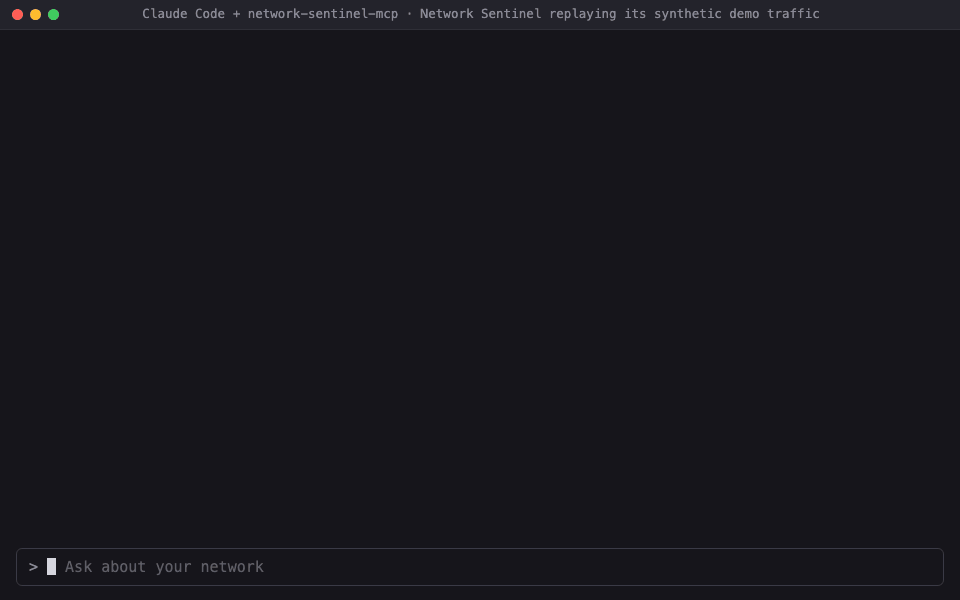

# Network Sentinel MCP

[](https://github.com/dannyleb/network-sentinel-mcp/actions/workflows/ci.yml)


**Ask Claude what your computer is doing on the network.**

A read-only [Model Context Protocol](https://modelcontextprotocol.io) server for
[Network Sentinel](https://github.com/dannyleb/network-sentinel), a local monitor of outbound traffic. Connect it to
Claude Desktop or Claude Code and ask, in plain language, what is leaving your machine, what looks risky, and what
to do about it. The server can look, but it can never touch.

<!-- Demo GIF: record Claude Desktop answering "Is anything on my network worth worrying about?" against
     Network Sentinel's `make demo`, save it as docs/demo.gif, and replace this block with:
      -->
> 🎬 *Demo GIF coming soon.*

## Contents

- [What it does](#what-it-does)
- [Example prompts](#example-prompts)
- [Why read-only](#why-read-only)
- [What leaves your machine](#what-leaves-your-machine)
- [Install](#install)
- [Connect it to Claude](#connect-it-to-claude)
- [Try it with MCP Inspector](#try-it-with-mcp-inspector)
- [How it works](#how-it-works)
- [Limits](#limits)
- [Development](#development)

## What it does

| Tool | Answers | Inputs |
|---|---|---|
| `get_recent_connections` | What has this machine talked to in the last N minutes? | `minutes` 1–1440 (default 15), `host` (part of a host name or IP), `limit` 1–200 (default 50) |
| `get_alerts` | Is anything wrong? | `severity` (minimum: `high`, `medium`, `low`, `info`), `since` (`"2h"`, `"7d"` or an RFC 3339 time, up to 30 days back; default 24h), `limit` 1–300 (default 50) |
| `get_top_destinations` | Where is my data going? Ranked by bytes sent, grouped by host. | `limit` 1–100 (default 10) |
| `explain_alert` | What does this alert mean, and what should I check? | `alert_id` from `get_alerts` |

| Resource | Contents |
|---|---|
| `sentinel://config` | What Network Sentinel is watching right now (interfaces or capture file, start time, AI gateway), all 17 alert rules and what each detects, and this server's input limits |

`explain_alert` pairs the alert with a built-in explanation of its rule (what it detects, why it matters, common
harmless causes, next steps) and with the connections, DNS lookups and other alerts for the same IP or host.
It works entirely offline: no model calls, no WHOIS or reputation lookups.

## Example prompts

- *"Is anything on my network worth worrying about right now?"*
- *"What's been uploading the most data today, and is any of it unexpected?"*
- *"Did anything send a password or API key unencrypted this week?"*
- *"Explain alert 16 and tell me what to check."*
- *"Has anything talked to anthropic.com in the last hour? How much did it send?"*
- *"Which AI services is this machine talking to?"*
- *"Summarize my network activity over the last 15 minutes like a security analyst would."*

## Why read-only

Network Sentinel watches everything leaving your computer. Giving an AI model a way to *change* that monitor
(clear alerts, edit blocklists, turn checks off) would turn a safety tool into an attack surface, since anything
that can steer the model could also switch the monitor off. So this server can only look:

- **One request, ever.** It only calls `GET /api/snapshot`. Network Sentinel's API has no write endpoints, and
  this server has no code path that writes anything, to the network or to disk.
- **Declared to the client.** Every tool is annotated `readOnlyHint: true`, `idempotentHint: true`,
  `openWorldHint: false`, so clients can let it run without confirmation prompts.
- **Bounded inputs.** Every argument has a range, length, pattern or allowed set, and unknown arguments are
  rejected before any data is fetched.
- **Untrusted text is defused.** Host names, DNS names and alert details come off the network, so a remote server
  could pick a name like `ignore-previous-instructions.example`. All such text is stripped of control,
  direction-changing and invisible characters and length-capped. The server also tells the model to treat it as
  data, never as instructions.
- **Enforced by tests.** A test fails if any tool isn't annotated read-only or has an unbounded input.

## What leaves your machine

**This server sends nothing anywhere.** It talks only to Network Sentinel on `127.0.0.1`. That is enforced in
code: the URL must be a loopback address, every connection is re-checked after DNS resolution, proxy settings are
ignored and redirects are never followed. There is no telemetry, no update check and no analytics.

**But your AI client does.** Whatever a tool returns becomes part of your conversation, and your client sends the
conversation to its model provider (Anthropic, for Claude). That can include host names, IP addresses, traffic
volumes and alert details. Secrets in alerts are already redacted by Network Sentinel: field names only, last
four digits of cards. Network Sentinel itself never sends your data to an AI model; connecting this server is
the opt-in.

Never returned at all: your machine's own LAN address, the contents of AI requests, Network Sentinel's secret
findings beyond the redacted alert text, and the dashboard token.

## Install

You need [Network Sentinel](https://github.com/dannyleb/network-sentinel) running on the same machine.

**With Go 1.25 or newer:**

```bash
go install github.com/dannyleb/network-sentinel-mcp/cmd/network-sentinel-mcp@latest
```

The binary lands in `$(go env GOPATH)/bin` (usually `~/go/bin`).

**Prebuilt binaries:** each [release](https://github.com/dannyleb/network-sentinel-mcp/releases) has macOS and
Linux builds for amd64 and arm64, plus `SHA256SUMS`. On macOS, a binary downloaded in a browser needs
`xattr -d com.apple.quarantine network-sentinel-mcp-darwin-arm64` before it will run.

**Without installing** (Go's answer to `npx`/`uvx`): point your client at
`go run github.com/dannyleb/network-sentinel-mcp/cmd/network-sentinel-mcp@latest`. Go compiles it on first launch
and caches the build, so the first start takes a few seconds.

### The dashboard token

Network Sentinel's dashboard needs a login token, which it keeps in a file called `token` in its data folder. This
server finds it automatically in the usual places:

| How Network Sentinel runs | Token file |
|---|---|
| macOS, `sudo netsentinel` or `make service` | `/Library/Application Support/NetworkSentinel/token` |
| Without `sudo` (for example `netsentinel -r capture.pcap`) | `~/Library/Application Support/network-sentinel/token` on macOS, `~/.config/network-sentinel/token` on Linux |
| Linux with `sudo` | root's config folder, which your account can't read: start Network Sentinel with `-data <dir>` and use `<dir>/token` |
| With `-data <dir>` | `<dir>/token` |

Otherwise, set one of these:

| Setting | Flag | Environment variable |
|---|---|---|
| Token file | `-token-file <path>` | `NETWORK_SENTINEL_TOKEN_FILE` |
| Token value | | `NETWORK_SENTINEL_TOKEN` |
| Dashboard address (must be on this machine) | `-url <url>` | `NETWORK_SENTINEL_URL` (default `http://127.0.0.1:8787`) |

The token file is only ever read. The token itself never appears in logs, errors or tool output.

## Connect it to Claude

### Claude Desktop

Add this to `~/Library/Application Support/Claude/claude_desktop_config.json` (Windows:
`%APPDATA%\Claude\claude_desktop_config.json`), then restart Claude Desktop:

```json
{
  "mcpServers": {
    "network-sentinel": {
      "command": "/Users/you/go/bin/network-sentinel-mcp"
    }
  }
}
```

Use the full path: Claude Desktop doesn't use your shell's `PATH`. If the token isn't in a default location, add
`"env": { "NETWORK_SENTINEL_TOKEN_FILE": "/path/to/token" }`.

To run it without installing, use `"command": "go"` and
`"args": ["run", "github.com/dannyleb/network-sentinel-mcp/cmd/network-sentinel-mcp@latest"]` (again with the full
path to `go` if needed).

### Claude Code

```bash
claude mcp add -s user network-sentinel -- network-sentinel-mcp
```

With a token file in a non-default place:

```bash
claude mcp add -s user -e NETWORK_SENTINEL_TOKEN_FILE=/path/to/token network-sentinel -- network-sentinel-mcp
```

Then run `/mcp` in Claude Code to check that it connected.

## Try it with MCP Inspector

[MCP Inspector](https://github.com/modelcontextprotocol/inspector) lets you call each tool by hand. It needs
Node.js 22 or newer.

No live traffic needed: Network Sentinel can replay a synthetic capture. In a clone of
[network-sentinel](https://github.com/dannyleb/network-sentinel):

```bash
make demo
```

Then, in this repository, open Inspector's web UI:

```bash
NETWORK_SENTINEL_TOKEN_FILE=../network-sentinel/testdata/demo-data/token make inspector
```

Inspector doesn't pass your shell's environment on to the server it starts, so the Makefile forwards
`NETWORK_SENTINEL_URL` and `NETWORK_SENTINEL_TOKEN_FILE` with `-e`. When you run Inspector yourself, pass them the
same way. For example, after `make build`, call one tool from the command line:

```bash
npx @modelcontextprotocol/inspector@2.14.0 --cli ./bin/network-sentinel-mcp -e NETWORK_SENTINEL_TOKEN_FILE=../network-sentinel/testdata/demo-data/token --method tools/call --tool-name get_alerts --tool-arg severity=high
```

## How it works

```
Claude Desktop / Claude Code / MCP Inspector
        │  MCP (JSON-RPC over stdio)
        ▼
network-sentinel-mcp
        │  GET /api/snapshot   Authorization: Bearer <token>   127.0.0.1 only
        ▼
Network Sentinel  ──  packet capture on this machine
```

- Each tool call fetches one snapshot from Network Sentinel's dashboard API, filters it, and returns structured
  JSON (with an output schema) that the model can reason over. Nothing is cached or stored.
- Times are measured on Network Sentinel's own clock, so "the last 15 minutes" also works when it replays an old
  capture file.
- Integrating over the dashboard API, rather than reading Network Sentinel's files, keeps the two projects
  decoupled. It's also the only complete source: connections and DNS lookups live in Network Sentinel's memory
  and never touch disk.
- Built with the official [Go MCP SDK](https://github.com/modelcontextprotocol/go-sdk) and the Go standard
  library, nothing else.

| Package | Role |
|---|---|
| `cmd/network-sentinel-mcp` | Flags, token discovery, stdio |
| `internal/sentinel` | Read-only, loopback-only client for the dashboard API |
| `internal/tools` | The four tools, the config resource, the rule catalog, input schemas, sanitizer |
| `internal/fixture` | Snapshots used by the tests |

## Limits

- **No process names.** Network Sentinel works from packets, so it can't say which app made a connection. For a
  connection that's still open, `lsof -nP -i @<ip>` will tell you, and `explain_alert` suggests it.
- **Network Sentinel must be running.** Connections and DNS lookups live in its memory. Alerts survive restarts,
  but alert IDs start again from 1.
- **Snapshots are capped** at the 500 connections that sent the most data, the 300 newest alerts and the
  150 newest DNS lookups. Tools add a note when an answer may be incomplete for that reason.
- **Some settings aren't visible** through the dashboard API: the large-upload threshold, which blocklists are
  loaded, and metadata-only mode.

## Development

```bash
make test    # go vet + go test -race
make lint    # gofmt + staticcheck
make vuln    # govulncheck
make check   # everything CI runs
```

The tests need no network, no root and no running Network Sentinel. They use recorded-shape snapshots in
`internal/fixture` (documentation IP ranges and reserved domain names only). Those snapshots include deliberate
traps: a host name carrying a terminal escape sequence, an alert from a rule this server doesn't know, and fields
that must never be exposed. Every tool call in the tests goes through the real MCP protocol via the SDK's
in-memory transport, and `cmd/network-sentinel-mcp` is tested end to end against a fake Network Sentinel over HTTP.

See [CLAUDE.md](CLAUDE.md) for the project rules, architecture notes and a checklist for adding a tool.

## License

[MIT](LICENSE)
